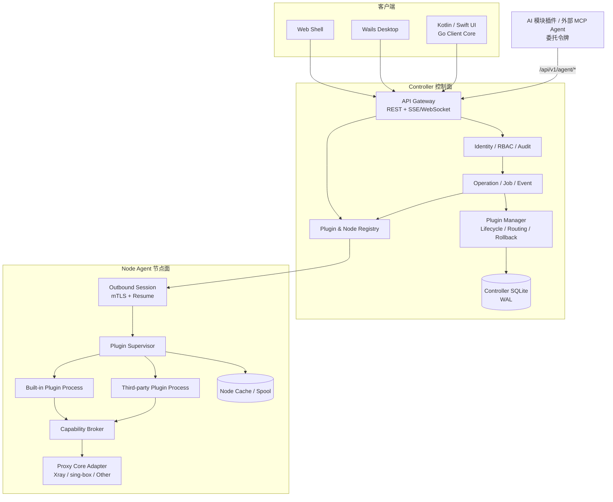
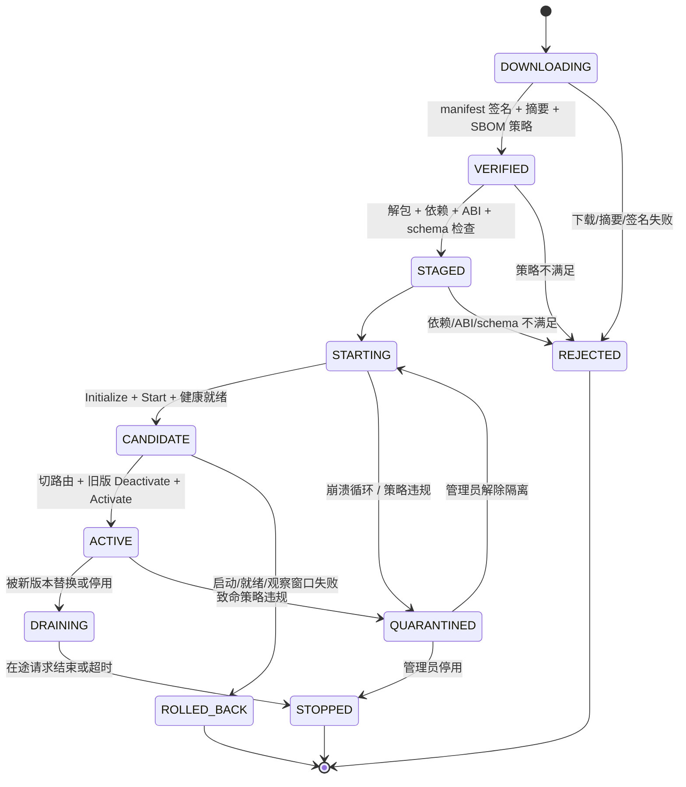

# 多功能模块化服务器运维面板：系统架构 v1.1

> 状态：架构基线 v1.1，已合入架构审查 P0 与 ADR-0002/0003/0004，可据此开始实施（见 `IMPLEMENTATION-PLAN.md`）  
> 日期：2026-11-01  
> 范围：宿主、节点、插件平台、通信、数据、安全、AI 操作面、客户端边界与交付路线；UI 规范见 `../ui-design/DESIGN.md`，不展开任何具体插件业务。  
> v1.1 变更：插件放置位置与实例模型（[ADR-0002](adr/0002-plugin-placement.md)）；插件拉起路径与本地传输认证（[ADR-0003](adr/0003-plugin-launch-and-transport.md)）；AI 原生操作面（[ADR-0004](adr/0004-ai-native-operation-surface.md)）；proto 与 manifest 按审查 C1–C11 重写；安全与运维细则见 [ARCHITECTURE-REVIEW.md](ARCHITECTURE-REVIEW.md)。v1 原文保存在 `../archive/v1-baseline/`。

## 0. 架构结论

采用 **Controller（控制面）+ Node Agent（节点面）+ Plugin Runtime（插件面）** 三层结构。单机部署时三者位于同一台 VPS；多节点时 Controller 只部署一份，各 VPS 运行 Node Agent。安装器可选择 `standalone`、`controller`、`agent` 三种角色，其中 `standalone = controller + 本机 agent`。

宿主长期稳定，但不等于“只做进程启动器”。宿主必须长期拥有以下横切能力：插件生命周期、ABI 与能力协商、身份/RBAC、审计、任务与事件、数据边界、API 网关、节点会话和密钥保护。业务功能全部放入插件。

**核心原则：业务可以热更，信任边界不能热更。**

**第二原则：人和 AI 走同一条写入通路。** 所有修改都是 Operation；界面只是服务端状态的投影，谁改的都会实时出现在所有打开的界面上（ADR-0004）。

### 0.1 对原方案的必要修正

1. go-plugin 是本地子进程/RPC 框架，不自动提供热切换、数据迁移、依赖解析或回滚；这些由 Plugin Manager 实现。其协议版本与应用 ABI 版本也必须分开管理。[1][ref-goplugin]
2. 插件热更新不是简单替换二进制，而是“准备新版本→验证→迁移→切换路由→旧版本排空”的事务式状态机。
3. systemd socket activation 能在宿主重启期间保留监听 socket 并排队新连接，但不等于保留旧连接；WebSocket/SSE 客户端必须重连。[2][ref-systemd]
4. sing-box 内部 Manager/Tracker 是跟随上游演进的 Go API，不应成为面板公共 ABI；只能封装在版本锁定的适配器内部。
5. 移动端复用的是 **Client Core**（API、会话、订阅、模型转换），不是 Linux Controller、go-plugin 和服务端数据库。gomobile 的导出类型限制也支持采用粗粒度 JSON/字节边界。[3][ref-gomobile]

## 1. 目标、非目标与不变量

### 1.1 目标

- 单 VPS 开箱即用，同一协议自然扩展到多 VPS。
- 插件热安装、热更新、热回滚，宿主不重启。
- 内置与第三方插件共用同一运行时和 ABI，差异只在签名与默认信任策略。
- 插件崩溃、死循环、内存失控不能拖垮宿主或其他插件。
- 上层面向稳定的 Core Intent Model，不直接依赖 Xray/sing-box 原生结构。
- Linux 服务端静态二进制；桌面与移动端复用可移植 Go 包。

### 1.2 首版非目标

- 不做多 Controller 高可用、分布式共识或多活写。
- 不引入 Kubernetes、NATS、Kafka、独立时序数据库。
- 不让第三方插件直接访问宿主数据库、任意文件、任意 shell 或任意网络。
- 不追求插件跨 ABI 大版本无感运行；不兼容时明确拒绝并保留旧版。
- 不在手机端运行 7×24 控制面或代理服务。

### 1.3 不可破坏的不变量

- 每个节点上的每个插件实例，任意时刻最多一个 `ACTIVE` 版本，更新期间可有 `CANDIDATE`；灰度期间不同节点的版本可以不同。同一时刻只有一个 generation 运行后台工作。
- 所有外部写操作都有 `request_id`，任务都有 `operation_id`，支持幂等和审计。
- 所有状态修改都经 Operation，没有只存在于前端的业务逻辑，也没有绕过 Operation 的数据写入；每次写入都发出变更事件（ADR-0004 D1、D3）。
- 每个可修改资源带 `revision`，修改必须带 `expected_revision`，冲突明确返回，不静默覆盖。
- 操作者分为人、AI、服务、系统；AI 的有效权限不超过委托人，高风险操作只能由真人批准。
- 插件只能获得显式授予的能力，不能通过回调获得宿主任意 Go 接口。
- 代理数据面不经过面板插件 RPC。
- 数据库迁移先向后兼容，再切版本；不能安全降级的迁移必须阻止自动回滚。
- 所有持久状态都有所有者、schema 版本和备份边界。

## 2. 总体逻辑架构



### 2.1 三条平面严格分开

| 平面 | 内容 | 协议与要求 |
|---|---|---|
| 管理面 | 浏览器/桌面/手机调用 Controller | HTTPS REST；SSE 为首选推送，WebSocket 用于双向交互 |
| 节点控制面 | Controller 与 Node Agent 的命令、结果、事件 | Agent 主动建立持久 gRPC/mTLS 连接，支持断线续传 |
| 本地插件面 | Supervisor 与插件子进程 | go-plugin + gRPC；每插件私有 UDS，双向 `SO_PEERCRED` 校验，不用回环 TCP（ADR-0003）；设置 deadline 与限额 |
| 代理数据面 | 用户实际代理连接 | 由 Xray/sing-box 等核心承担，绝不穿过插件 ABI |

## 3. 进程与部署边界

| 进程 | 默认权限 | 职责 | 不承担的职责 |
|---|---|---|---|
| `qwq-controller` | 普通系统用户 | API、身份、编排、注册表、Controller DB | 不执行插件代码，不直接改防火墙/代理核心 |
| `qwq-agent` | 普通系统用户 | 节点会话、插件监督、采集缓存、能力仲裁 | 不保存全局用户会话 |
| `qwq-privileged` | 最小必要 root/capability | 白名单系统操作、原子写系统配置、服务控制、渲染插件单元的资源 drop-in | 无通用 shell，无任意路径读写 |
| 插件进程 | systemd 模板单元 `qwq-plugin@<id>`，独立 UID，沙箱模板 | 业务逻辑、UI 后端 operation | 不直接访问其他插件数据；不由 Agent 直接 exec（ADR-0003） |
| 代理核心 | 按核心需求独立配置 | 数据转发、原生统计 | 不感知面板用户与 RBAC |

首版可把 privileged helper 与 agent 做成**同一静态二进制的不同子命令**，但必须是不同进程和不同 IPC 授权。不能为了方便让所有插件跟随 root 宿主运行。

### 3.1 三种安装角色

- `standalone`：Controller + 本机 Agent，使用本地 UDS；默认单机形态。
- `controller`：控制面，等待远端 Agent 主动接入；装有 `placement=controller` 的插件时附带一个只运行这类插件的本机 Agent，本机不注册为受管节点（ADR-0002）。
- `agent`：探针/受管节点形态，仅运行节点监督器、缓存和已下发插件。

节点安装包与面板安装包可共用二进制和角色参数，但 systemd unit、目录权限和开放端口不同。Agent 不监听公网管理端口，避免 NAT/防火墙入站配置。

### 3.2 节点接入

1. Controller 创建一次性、短有效期 enrollment token，并绑定节点名称与过期时间。接入命令同时携带 Controller CA 公钥指纹（`--ca-hash sha256:…`）；接入脚本先下载、验签，再执行，不使用 `curl | sh`。
2. Agent 首次连接时用指纹校验 Controller（Controller 使用公开 CA 证书时可用常规校验），再发起 enroll，生成节点私钥和 CSR；私钥只存在节点。
3. Controller 忽略 CSR 中的 Subject 与 SAN，只把自己分配的 `node_id` 写入证书（URI SAN `qwq://node/<id>`），返回节点证书、Controller CA 与初始配置版本。`NotBefore` 回拨几分钟以容忍时钟偏差。
4. Agent 之后仅用 mTLS 连接；token 立即失效。节点证书短有效期（默认 30 天），在会话内自动轮换；吊销在握手时查本地 deny-list。此后所有消息的 `node_id` 都从证书取。
5. 每个节点维护 `last_acked_event_seq`，断线后增量补发；超过保留窗口则重新同步快照。
6. 节点通道使用独立端口，强制客户端证书，只允许 TLS 1.3；CA 私钥与对外 HTTPS 证书私钥分开存放。Controller 对节点消息限制大小、频率与 schema，节点上报的字符串一律按不可信文本处理（审查 S4、S6）。

## 4. 宿主模块职责

```text
API Gateway
 ├─ AuthN / AuthZ / CSRF / Rate limit
 ├─ Public REST API / Event stream
 └─ Plugin operation router
Control Services
 ├─ Node Registry & Session Manager
 ├─ Operation Manager（同步请求与长任务统一模型）
 ├─ Event Journal（有界、可续传，不是无限消息队列）
 ├─ Plugin Manager / Dependency Resolver
 ├─ Package Verifier / Trust Store
 └─ Audit / Config / Secret reference
Adapters
 ├─ SQLite repositories & transactional outbox
 ├─ systemd / cgroup / UDS
 └─ Local & remote Node Driver
```

### 4.1 API 约定

- 对外前缀 `/api/v1`，只暴露稳定 DTO，不暴露 proto 或 Go 内部模型。OpenAPI 3.1 是公共 DTO 的唯一来源，生成 Shell 的 TypeScript 客户端与 `clientcore` 的 Go 客户端。
- 查询：`GET /api/v1/...`，支持 `fields=`（字段投影）与 `since_revision=`（增量）；长操作返回 `202 + operation_id`。
- 插件调用（ADR-0002）：node 级 `POST /api/v1/nodes/{node_id}/plugins/{plugin_id}/instances/{instance_id}/operations/{operation}`；controller 级 `POST /api/v1/plugins/{plugin_id}/operations/{operation}`。插件公开路由挂在 `/p/{plugin_id}/...`，会话 Cookie 的 `Path=/api/`，公开路由收不到会话。
- 任务：`GET /api/v1/operations/{id}`；批准：`POST /api/v1/approvals/{id}`（只接受真人会话）；事件流使用 `Last-Event-ID` 续传。
- 所有变更请求带 `Idempotency-Key`，作用域为"用户 + 路由"，TTL 24 小时，容量有上限；相同 key + 相同 body（规范化后哈希）返回原结果，不同 body 返回冲突，并发的同 key 请求返回 409。
- 修改资源必须带 `expected_revision`，不匹配返回 `409 REVISION_CONFLICT` 并附当前 revision（ADR-0004 D2）。
- 错误使用 RFC 9457 Problem Details（`application/problem+json`），扩展字段 `code`、`retryable`、`request_id`、`violations[]`（JSON Pointer 字段级错误）；不把 panic/SQL/路径返回客户端。
- 网关在 schema 校验前限制请求体大小与 JSON 嵌套深度；schema 在安装时编译并缓存；插件 schema 禁止远程 `$ref`。
- 所有 RPC 有 deadline；调用链传播 trace_id、actor（含 `on_behalf_of`）、node_id 和 plugin_id。
- AI 操作面：`/api/v1/agent/*` 提供固定工具 `find_actions / describe_action / read / plan / execute / wait / cancel`，鉴权使用委托令牌（ADR-0004 D8）。

### 4.1.1 会话与管理入口（审查 S8）

- 首次初始化不设默认密码：安装时打印一次性初始化链接，或只监听 `127.0.0.1` 经 SSH 隧道初始化。
- 不在公网明文提供登录页：有域名用 ACME，否则生成自签名证书并打印指纹。
- Cookie `HttpOnly; Secure; SameSite=Lax; Path=/api/`；登录与提权时轮换会话 ID；空闲与绝对超时。WebSocket/SSE 握手校验 `Origin` 与 `Host` 白名单。
- 身份模型预留 TOTP/WebAuthn 与敏感操作二次验证；登录按账号 + IP 渐进退避，不硬锁定；口令哈希（argon2id）用信号量限制并发。
- 只信任来自已配置反代地址的 `X-Forwarded-For`。
- 仅 root 可用的 `qwq recover` 用于重置管理员、关闭 MFA、恢复监听配置，全部写审计。
- 改变可达性的系统能力（防火墙、SSH、面板端口/TLS）并入普通审批分级（ADR-0016）：动作的 `approval` 不得低于 `ai_confirm`、风险不得低于 `high`，由宿主在目录加载时钳制；没有倒计时确认。

### 4.2 事件不是数据库替代品

采用有界事件日志 + 快照，而非完整 Event Sourcing。业务当前状态仍由关系表保存；事件用于通知、续传和集成。事件至少包含：

```text
event_id, sequence, type, schema_version, subject, occurred_at,
actor{kind,id,on_behalf_of}, node_id, trace_id, operation_id, delivery_class, payload
```

字段与 proto `Event` 一致。插件发布时只能提交 `EventDraft { type, schema_version, subject, payload }`，其余字段由宿主填写。每次资源修改在同一事务中经 outbox 写入 `resource.changed { subject, revision, actor, operation_id, changed_pointers[] }`，operation 进度发 `operation.updated`；Shell 据此更新界面（ADR-0004 D3）。插件自有资源由插件上报 `ResourceChange`，宿主与 operation 结果一起写 outbox（ADR-0007）。可靠事件为 at-least-once，订阅方按 `event_id` 去重，用 `AckEvents` 或 `last_acked_sequence` 续传。

热路径指标采样与低频领域事件分流。宿主按 topic 策略决定投递等级，插件不能自行把普通事件提升为可靠/审计事件。插件写的审计与宿主审计分开配额并标注来源，超限只限流该插件；Agent 按插件限制 stderr 日志的读取速率与单行长度：

| 通道 | 慢消费者与恢复策略 |
|---|---|
| 实时指标、在线状态 | 固定容量；允许合并或丢弃中间样本并计数，最新快照可恢复 |
| 配置、任务结果 | 不丢弃；持久化，按 sequence/revision 恢复 |
| 审计、安全告警 | 不静默丢弃；写本地 journal/spool，超限触发背压与告警 |
| 普通通知 | 有界队列，允许明确标记丢失 |

不为每个事件创建 goroutine，不使用无界 channel。订阅、重连和丢失计数都纳入可观测性；普通广播不引入跨插件 waterfall，避免同步 RPC 链、循环调用和部分执行。

## 5. 插件平台

### 5.1 包结构

```text
plugin-id_version_os-arch.ppkg
├── manifest.json          # 身份、版本、ABI、依赖、能力、入口、摘要
├── bin/plugin             # 对应 OS/Arch 的可执行文件
├── ui/                    # 可选：静态构建产物，不携带运行时远程脚本
├── schemas/               # operation 请求/响应 JSON Schema
├── migrations/            # 插件自有状态迁移
├── docs/                  # 可选：operation 说明与示例，供 describe_action 按需加载
├── attestations/          # SBOM（必需）与构建来源证明（in-toto/SLSA）
├── assets/
└── signatures/
    └── manifest.sig       # 对 manifest.json 原始字节的 Ed25519 分离签名
```

`manifest.sig` 是 JSON 信封 `{"key_id": "ed25519:<64 位十六进制>", "signature": "<base64>"}`：`key_id` 为 `ed25519:` + 原始公钥 SHA-256 的完整十六进制，签名是对 manifest.json 原始字节的普通 Ed25519（不预哈希、无 context）。信封自带 key_id，所以能在解析 manifest 之前完成验签；验签后再核对 manifest 中的 `publisher.key_id` 与之相同（实现见 `sdk/manifest`）。

版本目录不可变：`/var/lib/qwq-plugins/<id>/<version>/`，归 root 且只读；激活指针是 DB 记录而非唯一事实来源。至少保留当前版和上一已知良好版，磁盘配额下禁止删除 ACTIVE。

### 5.2 四层版本必须独立

| 版本 | 用途 | 兼容策略 |
|---|---|---|
| go-plugin protocol | 进程握手与传输 | 仅随 go-plugin 集成层升级 |
| Platform ABI | 生命周期、Host Service、事件等公共契约 | major 必须匹配；minor 向后兼容 |
| Plugin API | 某插件 operation 与 UI 契约 | 每插件独立 semver |
| State schema | 插件私有持久状态 | 独立迁移与回滚规则 |

不能把四者共用一个“版本号”，否则任何小改都会被迫升级全部插件。

### 5.3 manifest 必备内容

- 身份：`schema_version`（`1.N`，宿主拒绝更高的 minor）、`id`、`version`（SemVer 2.0）、`name`、`summary`、`publisher{id, key_id=公钥指纹}`、`abi`、`engine_constraint`；可选 `description/license/homepage/icon`。
- 包：单个 `target`（如 `linux/arm/v7`）、`entrypoint`、`files`（除 manifest 与签名外的全部文件，`sha256:` 摘要）、`provenance{sbom, build}`。签名为分离签名，先验签后解析，解析拒绝重复键和未知字段。
- 放置与生命周期：`placement: node | controller`（ADR-0002）；`lifecycle{startup: eager|on_demand, background, update_strategy, overlap_safe}`，`background=true` 必须 `eager`，`overlap_safe=false` 必须 `restart`；`node_requirements`。
- 依赖区分 `plugin/service` 与 `required/optional`，带 semver range；`conflicts`、`replaces` 显式表达。
- 能力请求：`name + scope + reason`；敏感能力在安装和升级新增时重新确认。
- operations：`name`、`api_version`、`permission`、`mode(invoke|job)`、`effect(read|write|destructive)`、`risk`、`idempotent`、`plannable`、`timeout_ms`、`summary`、`docs`、`undo`、`ui_route`、`capabilities`（本 operation 用到的能力，插件级声明的子集；风险下限按它计算，ADR-0007）、请求/响应 schema（ADR-0004 D5）。`destructive` 必须 `risk=high`；`read` 必须幂等。可选 `reachability`（schema 1.3，ADR-0018）标记会切断管理通道的操作：必须是 `write`/`destructive`、`risk=high`，且不得声明 `approval=auto`。
- `config.schema` 与 `hot_apply`：配置先静态校验，再执行插件预检；敏感字段标 `writeOnly: true` 或 `x-secret: true`，宿主保存为 secret 引用，配置历史、事件、导出和备份中不出现明文。
- UI：`entry`、`sandbox: true`、`kit_major`、`connect_sources`（只允许 https 源，安装向导作为敏感权限展示）、`routes`（路径、标题、导航、权限）；可选 `widgets`（schema 1.3，ADR-0018）：由 Shell 原生渲染的概览小组件，数据来自本插件的只读 operation。
- `state{schema_version, minimum_rollback_version, backup_paths}`；`resources{memory_max_mb, cpu_quota_percent, pids_max, fds_max, disk_max_mb, kv_max_kb}`。`disk_max_mb` 为软限制（定期统计 + 告警）。

所有路径字段都是安全相对路径（schema 中的 `relpath`）。schema 表达不了、由安装器检查的规则：大小写与 Unicode 规范化后去重；`entrypoint`、schema、docs、SBOM 等引用必须出现在 `files` 中；`undo` 必须是本插件已声明的 operation；`ui_route` 必须在 `ui.routes` 中；operation 级 `capabilities` 必须是插件级声明的子集（不允许空列表，省略表示全部）；`files` 不能列出 `manifest.json` 与 `signatures/`，同一路径不能既是文件又是目录；`ui.routes` 的 path 不重复；`ui.widgets` 的 id 不重复，其 `operation` 必须是本插件 `effect=read`、`mode=invoke` 的 operation；较新 minor 才有的成员不得出现在声明更低 minor 的 manifest 中；显示给用户的单行文本不得含控制字符与双向覆盖符；manifest 不超过 256 KiB，嵌套不超过 64 层，数字必须是 ±(2^53−1) 内的整数，`schema_version` 的 minor 高于宿主支持时拒绝。规则的 Go 实现（`sdk/manifest`）与 `tools/manifest_check.py` 共用 `api/manifest/v1/testdata/cases.json` 中的用例，两边结论必须一致。

包内 manifest 是安装策略的权威来源；插件 `GetDescriptor` 返回的能力、operation 和配置声明必须与 manifest 一致，不一致时拒绝加载。Schema 见 [`api/manifest/v1/manifest.schema.json`](../api/manifest/v1/manifest.schema.json)，示例见同目录 `examples/`，校验脚本为 `tools/manifest_check.py`。

### 5.4 ABI 设计

公共 ABI 只放稳定的平台原语，具体业务使用版本化 operation envelope：

- 进程级：`GetDescriptor`，进程存活用 go-plugin 自带的 `grpc.health.v1`。
- 实例级（`RequestContext.instance_id` 指明实例）：`Initialize / Start / Activate / Deactivate / Stop / ReleaseInstance / CheckHealth / ValidateConfig / ApplyConfig / Invoke / RunJob / PlanOperation / ServePublicRoute`。`Start` 只表示可接请求，后台工作在 `Activate` 之后才开始。`ServePublicRoute` 响应 `/p/{plugin_id}/...` 的公开请求（ADR-0002），宿主剥离 Cookie 与 Authorization。
- `RunJob` 接收长任务；插件上报进度，宿主负责取消与超时。`PlanOperation` 无副作用地返回变更预览与 preconditions，`Invoke/RunJob` 原子校验 preconditions（ADR-0004 D7）。
- Host Service：`HostStateService`（含 `ListState`）、`HostEventsService`（含 `ReportChanges`）、`HostConfigService`、`HostSecretsService`、`HostAuditService`、`HostInvokeService`（含 `WaitOperation`、`CancelOperation`）。由 Agent 在每插件私有 UDS 上提供；每个 RPC 检查自己需要的能力（ADR-0003、ADR-0007）。
- 资源变更：插件修改自有资源后用相对 subject 上报 `ResourceChange`（`InvokeResponse.changes`、`JobProgress.changes`，操作之外用 `ReportChanges`），宿主加命名空间前缀后发出 `resource.changed`；插件不能发布 `resource.*`、`operation.*` 事件（ADR-0007）。
- 错误约定：gRPC 状态码表示传输与宿主侧失败；到达处理函数后的业务结果用 `ErrorDetail` 的稳定 code，字段级错误在 `ErrorDetail.violations`。
- 身份推导：插件身份与 generation 取自传输层（`SO_PEERCRED` + cgroup 单元名），且每次 Host 调用须携带安装时签发的插件 token（metadata `qwq-plugin-token`，宿主只存 SHA-256，ADR-0013）；实例取自 `Initialize` 下发的不透明 `instance_handle`，generation 结束即失效；插件回传的 actor、node、trace 只用于日志关联（审查 C2）。
- 跨插件调用经 `HostInvokeService.InvokePlugin`：点对点、宿主中介，检查 `plugin.invoke:<plugin_id>/<operation>` 能力、校验 schema、传播 deadline、写审计，路由到 ACTIVE generation；不是通用 waterfall。
- 高风险系统能力使用独立、版本化 Host Capability 服务，不存在通用 `Exec`、`ReadFile`、`HTTPRequest`。
- `Invoke` 的 payload 是带 schema 的 JSON bytes，不用无约束 `Any`；元数据仍使用强类型 proto 字段；校验错误返回 `FieldViolation`。
- 默认单请求 4 MiB、有限并发、有限流消息；大文件使用带授权和校验的分块传输服务，不嵌入普通 RPC。

参考契约见 [`api/qwq/platform/v1/platform.proto`](../api/qwq/platform/v1/platform.proto)，冻结评审见 [ADR-0007](adr/0007-platform-abi-v1-freeze-review.md)；命名遵守 Buf STANDARD lint。节点协议草案见 [`api/qwq/node/v1/node.proto`](../api/qwq/node/v1/node.proto)，随 P4 冻结。

### 5.5 插件前端隔离

Web Shell 只加载已签名的静态 UI 包：

- 第三方 UI 放入 `sandbox="allow-scripts"` 的 iframe（按需加 `allow-forms`、`allow-downloads`）。**`allow-scripts` 与 `allow-same-origin` 不能同时出现**；禁止 `allow-top-navigation*` 与 `allow-popups-to-escape-sandbox`。插件静态资源响应头带 `Content-Security-Policy: sandbox allow-scripts; …` 与 `X-Content-Type-Options: nosniff`。
- iframe 的 origin 是 `"null"`。Shell 校验 `event.source === iframe.contentWindow` 后为每个 iframe 建立专用 `MessageChannel`，之后只经 port 通信；宿主 API 的 CORS 永远不允许 `Origin: null`。桥接层只代理该插件自己的 operation 命名空间，不代理宿主级 API 与其他插件（审查 S7）。
- iframe 不继承宿主 localStorage、Cookie 或 DOM；CSP 禁止远程脚本和未声明连接。插件包自带版本化的 Liquid UI Kit，主题、动效、密度经 port 同步，首帧主题经 URL hash 传入（`ui-design/DESIGN.md` §7）。
- 节点与插件提供的字符串（主机名、错误、进度消息、插件名称与说明）只做文本渲染，禁止 `innerHTML`；插件图标只用 ``，不内联 SVG（审查 S6）。
- 内置受信插件可使用同一机制，不能因“内置”获得隐式 DOM 权限。
- 前端贡献点只包括路由、面板、导航和声明式设置页；不允许插件向宿主任意注入全局 CSS/JS。
- 设置页优先由 `config.schema` 自动生成字段和字段级错误；复杂插件才提供受控自定义 UI。
- 安装向导固定展示权限、依赖、资源预算和预检结果；安装、更新、卸载均显示 operation 进度，冷启动不静默卡住。

这样牺牲一点嵌入自由度，换取第三方商城上线后的基本安全性和一致体验。

### 5.6 状态与数据所有权

- Controller DB 仅宿主可访问，插件不能直接连库。
- 小型插件状态通过 scoped KV API，存放在 Agent 本地、每插件一个文件，不进 Controller DB，避免与控制面争抢写锁；复杂状态使用插件私有 SQLite 文件，宿主只管理路径、配额、备份和迁移状态。
- 跨插件共享数据必须经公共版本化服务/事件或 `InvokePlugin`，不读取对方数据库。
- Secret 以引用保存。取明文只能经 `RevealSecret`：需要 `secret.reveal:<ref>` 能力，且必须带正在派发给本实例的 `operation_id`；每次取值写审计并限频。能由宿主代做的敏感动作优先由宿主代做。宿主禁止将 secret 写入日志和事件。
- 默认作用域是 `node_id + plugin_instance_id`，由 SDK 强制命名空间隔离；不按节点/租户自动复制进程。只有高风险或明确需要故障隔离的实例才选择独立进程。
- 不为尚未确定的多租户需求预设全局 Scope 系统；未来增加 tenant_id 时必须贯穿 RBAC、数据所有权和事件主题。

### 5.7 宿主资源所有权与自动清理

所有宿主侧注册都归属于 `plugin_instance_id + process_generation`，包括路由、事件订阅、活动流、定时器、任务、监听器、临时能力授权和 `instance_handle`。宿主提供统一且幂等的 `Cleanup(owner)`，在正常停止、崩溃、强杀、更新和卸载时调用。

插件自己的清理钩子只是优化，不是正确性的前提；即使插件来不及响应，宿主也能撤销全部登记项。新 generation 不得继承旧 generation 的流和回调。路由切换使用不可变快照原子替换，清理旧 owner 前等待在途请求结束或超时。

## 6. 插件生命周期与事务

### 6.1 状态模型

版本状态与安装状态分开建模。下图是**某节点上某插件实例组的一个版本**的生命周期：



任一版本进入 REJECTED、ROLLED_BACK 都不改变当前 ACTIVE 版本。安装与卸载的状态见 §6.6。

### 6.2 安装

校验包大小→对 manifest.json 原始字节验签→严格解析 manifest（拒绝重复键与未知字段）→schema 与安装器规则校验→检查平台/ABI/依赖/节点能力→计算能力差异→用户确认敏感授权→解压到临时目录→原子 rename→配置 JSON Schema 校验→插件 ValidateConfig→启动→健康检查→注册路由。任一步失败都不改变 ACTIVE 集合。复杂插件可在安装向导中执行预检，但预检不能代替启动前校验。

解包用 Go 1.24 的 `os.Root` 把所有文件操作限制在目标目录内；拒绝符号链接、硬链接、设备文件、setuid 位、未在 `files` 中列出的文件；校验每个文件的摘要；包目录归 root 且只读。插件索引采用 TUF 模型（`go-tuf`），本地记录见过的最高版本以拒绝回滚和冻结攻击，降级插件必须由用户显式操作。

### 6.3 更新

1. 获取单插件更新锁并解析依赖，不持全局锁。
2. Staged 新版本，比较 ABI、能力、operation 与 state schema。
3. 执行 **expand-only** 迁移，使新旧代码均可工作。
4. 启动候选版（`Initialize` + `Start`），执行 readiness 与插件自检；沿用同一 plugin instance identity。候选版此时不运行后台工作。
5. 新请求原子路由到候选版 → 旧版 `Deactivate`（停止定时器、订阅等后台工作）→ 候选版 `Activate` → 旧版 `Stop(drain)` → `ReleaseInstance`。后台工作可能有短暂空档，但不会双跑；声明 `overlap_safe=false` 的插件强制走受控重启。
6. 观察窗口内错误率/健康异常则自动切回旧版。
7. 成功后标记新版本 ACTIVE；破坏性 contract migration 延后到明确确认或后续版本。

**回滚限制：**若新版本已执行不可向后兼容的数据迁移，不能假装“切回二进制”就是回滚。此时只能恢复备份或运行兼容层，manifest 必须提前声明。

**小内存更新：**蓝绿期间会短暂运行新旧两个进程。更新前按 cgroup 实际用量和可用内存做 preflight；内存不足或插件声明 `restart` 时，降级为“保存状态→停旧→启动新版→失败恢复旧版”的受控重启，明确报告短暂中断，禁止为追求零中断触发 OOM。1 核 1G 节点默认插件更新并发为 1。

**运行时内存防线**（Go 运行时不读取 cgroup 内存上限）：Supervisor 为每个插件设置 `GOMEMLIMIT ≈ 0.85 × memory_max_mb`，单元设置 `MemoryHigh ≈ 0.9 × MemoryMax`；Controller/Agent 的 `OOMScoreAdjust` 为负值、插件为正值，内存不足时内核先杀插件。preflight 读 `MemAvailable` 与 cgroup `memory.current`。不对 Go 二进制使用 UPX。

### 6.4 崩溃、重启与收敛

- 期望状态（启用、版本、配置 revision）持久化；实际状态由进程监督器维护，两者通过**事件驱动的 Reconciliation** 收敛。
- 进程退出、配置提交和安装请求立即触发对应插件的收敛；30–60 秒低频扫描仅用于修复漏事件，不做高频轮询。
- 进程退出→带抖动指数退避重启（1s→2s→4s→…→5min 上限）；连续失败进入 `QUARANTINED`，不形成重启风暴。
- 宿主重启从 DB desired state 恢复。插件是 systemd 单元，首次启动与宿主重启恢复都用 `ReattachConfig` 连接；进程身份以 systemd MainPID 与 cgroup 归属为准，入口文件摘要由 `ExecStartPre` 校验，连接时双向校验 `SO_PEERCRED`（ADR-0003）。
- 更新请求、路由切换与 DB 状态使用同一事务或可恢复 saga；进程在任一步被杀都能继续或回退。
- 依赖按拓扑顺序启动；循环依赖拒绝安装。硬依赖缺失时阻止启动；运行中上游消失时暂停下游调用并等待恢复，不默认连锁卸载。可选依赖只降级能力。
- 停用被依赖插件前必须阻止或显式级联确认。所有收敛动作带退避、单插件锁和可取消 context。
- 启动策略默认 `eager`；纯 UI 型插件可配置 `on_demand`，由首次 operation、导航或依赖方请求唤醒。需要持续订阅事件的后台插件必须 `eager`。冷启动在 UI 中显示明确进度和超时，不假装即时完成。

### 6.5 配置 revision 与热应用

配置使用不可变 JSON 快照，当前生效版本由指针引用；代码版本和配置版本独立回滚。

```text
保存候选配置 revision N
  → 宿主按 config.schema 校验
  → 插件 ValidateConfig(N)
  → 支持 hot_apply：插件 ApplyConfig(N) 并确认 applied_revision=N
  → 宿主原子提交当前配置指针
  → 失败或超时：继续使用 N-1，记录字段级错误
```

不支持热应用的插件执行一次受控重启。配置只能由宿主写入，插件不能自行修改当前配置；启动时传入 `config_revision`，健康检查报告实际应用 revision。旧配置快照的默认保留策略：保留最近 20 个，并保留 30 天内的全部（取并集），可配置。快照中的敏感字段只存 secret 引用。

### 6.6 事务式卸载与 Finalizer

卸载是独立事务，不允许“杀进程 + 删目录”：

```text
安装：REQUESTED → AWAITING_APPROVAL（敏感能力）→ INSTALLING（按 §6.1 推进版本）→ INSTALLED / FAILED
卸载：REQUESTED → DEPENDENTS_CHECKED → RUNTIME_STOPPED → RESOURCES_CLEANED
      → DATA_RETAINED / DATA_DELETED → COMPLETED
      任一步失败 → CLEANUP_FAILED（可重试，保留阶段与诊断）
```

- 默认保留用户数据；卸载只清理代码、进程、路由、订阅和权限。彻底删除数据需要单独确认。
- 有下游依赖时阻止卸载，并列出依赖者；不静默级联删除。
- Finalizer 由宿主内置实现，不是可被插件跳过的可选回调；每一步幂等，失败保留当前阶段和诊断信息。
- 清理失败进入 `CLEANUP_FAILED`，支持重试；不得把插件标记为已卸载却留下活动路由或订阅。

## 7. Operation、任务与一致性

统一入口：

```text
Client Request（人：会话；AI：委托令牌；服务：服务账号）
  → Gateway auth + schema validation + 有效风险计算
  → Operation record (pending, actor, on_behalf_of)
  → [需要批准] awaiting_approval → approved / rejected / expired
  → local plugin call OR node command（校验 preconditions）
  → running / succeeded / failed / canceled
  → result + events（operation.updated、resource.changed）+ audit
```

批准、计划与执行绑定、风险分级和面向 AI 的固定工具见 [ADR-0004](adr/0004-ai-native-operation-surface.md)。人与 AI 的 operation 进入同一队列，遵守同一并发上限。

- 快操作可同步等待并返回结果；超过短阈值自动转为异步 operation。
- Controller 持久化任务意图，Agent 持久化执行状态；重启后可恢复。
- `operation_id + attempt` 标识执行；非幂等任务不自动重试。
- Agent 离线时仅对明确允许排队的操作排队，并设置 TTL；实时操作立即返回 `NODE_OFFLINE`。
- 事件和 DB 更新采用 transactional outbox，避免“状态已提交但事件丢失”。
- 节点命令携带 `desired_revision`；Agent 上报 `applied_revision` 和错误，配置管理可收敛而非依赖一次 RPC 成功。

## 8. 数据与指标架构

### 8.1 存储选型

Controller 使用纯 Go SQLite 驱动、WAL、busy timeout、外键和受控连接池；该驱动不需要 CGO，符合静态二进制目标。[4][ref-sqlite] Repository 接口隔离存储实现，未来可迁移 PostgreSQL，但首版不为此做分布式抽象。

核心表分组：

```text
identity: users, sessions, roles, service_accounts
nodes: nodes, node_certificates, node_revisions
plugins: packages, installations, versions, config_revisions, grants, routes, migrations, uninstall_operations
operations: operations, attempts, plans, approvals, idempotency_keys, outbox, event_journal
agent: delegations
audit: audit_log
system: schema_migrations, settings, secret_metadata, host_resources
```

所有可修改资源表带 `revision`；`operations` 带 actor（kind、id、on_behalf_of）与 §7 的状态。插件 KV 不在此库中（§5.6）。

写入纪律（审查 O3）：一个写连接加一个小的只读连接池；所有写事务以 `BEGIN IMMEDIATE` 开始，避免 WAL 下读升级为写时直接 `SQLITE_BUSY`；节点事件、指标批次与 outbox 按时间窗或条数组提交；保持 `synchronous=FULL`，压测确有瓶颈再评估；读事务要短，设置 `journal_size_limit`，空闲时 `wal_checkpoint(TRUNCATE)` 并监控 WAL 大小；1G 机器限制 `cache_size` 与连接数；outbox 投递在提交后由进程内信号唤醒，低频轮询兜底。

### 8.2 指标不无限写 SQLite

- Agent 本地保留短窗口环形样本和断线 spool，批量压缩上传。
- Controller 原始高分辨率数据短保留，随后降采样；历史保存周期是策略而非无限增长。
- 计数器同时上报 `counter_value + reset_epoch + observed_at`，由接收端处理核心重启归零，避免负流量。
- 在线状态来自心跳和会话，不用每次页面刷新同步扫描所有节点。
- 指标与审计分开保留；审计日志不可被普通插件删除。

### 8.3 备份

备份包括 Controller DB 一致性快照、插件声明的持久状态、配置和公钥元数据；私钥/secret 使用独立加密备份。恢复流程必须在全新 VM 定期演练。单一 SQLite 文件拷贝不等于一致性备份，快照使用 `VACUUM INTO` 或在线备份 API。

## 9. 代理核心统一抽象

Core API 是**节点内的版本化能力契约**，代理驱动作为插件实现；它不是宿主框架的固定 Go interface。

```text
Core Intent Model（面板所有）
  ├─ CoreDriver.Xray（独立插件，锁定 Xray API 版本）
  ├─ CoreDriver.SingBox（独立插件，锁定 sing-box Go 模块版本）
  └─ Future Driver
```

驱动统一实现四类操作：

| 操作 | 语义 |
|---|---|
| `Capabilities` | 支持的协议、统计、在线用户、动态路由、速率限制等 |
| `Validate / Plan` | 校验 intent，生成变更计划与警告，不产生副作用 |
| `Apply` | 按 revision 应用，返回实际状态；部分不支持必须显式报错 |
| `Observe` | 状态、标准化计数器、连接事件；批量上报 |

架构规则：

- Intent 使用面板自有 DTO，禁止把 Xray JSON 或 sing-box `option.Options` 泄漏给上层。
- 每个驱动可做原生配置渲染，但“支持交集”与“核心扩展”分开；扩展必须命名空间化。
- `Apply` 先生成完整快照和回滚点，配置错误不得摧毁最后可用配置。
- 统计标识稳定：`core_instance / inbound / user` 使用面板 ID，不直接把 email/tag 当永久主键。
- sing-box 作为 Go 库嵌入驱动进程，不嵌入宿主；上游升级在驱动内消化并通过兼容测试。
- Xray API 只启用所需服务，优先 UDS + 文件权限；必须用 TCP 回环时，只允许对应 Core Driver 访问，其他插件靠 `PrivateNetwork=yes` 与出站代理的回环拒绝规则挡住。回环地址不是信任边界（审查 S3）。官方 API 包含 HandlerService、StatsService、RoutingService 等。[5][ref-xray]
- 多驱动可并存；是否默认安装哪个核心是产品/插件决策，架构不预设。

## 10. 安全与沙箱

### 10.1 信任模型

go-plugin 提供崩溃隔离，**不是安全沙箱**。子进程默认仍继承 OS 可访问资源，因此必须叠加 OS 隔离。官方也仅将其描述为“相对安全”的接口隔离，并支持校验和与 TLS。[1][ref-goplugin]

### 10.2 默认隔离

- 插件经 systemd 模板单元 `qwq-plugin@<id>` 运行，独立 UID，cgroup v2 限制 CPU、内存、PIDs、文件句柄（ADR-0003）。
- 默认沙箱模板由宿主维护，插件不能直接声明 systemd 指令：`PrivateNetwork=yes`、`RestrictAddressFamilies=AF_UNIX`、`NoNewPrivileges`、`ProtectSystem=strict`、`ProtectHome`、`PrivateTmp`、`PrivateDevices`、`ProtectProc=invisible`、`SystemCallFilter=@system-service ~@privileged @resources`、`SystemCallErrorNumber=EPERM`、空 `CapabilityBoundingSet` 等，完整模板见审查 S2。CI 与 `qwq doctor` 用 `systemd-analyze security` 设分数门槛。
- 能力到放宽项的映射由宿主定义（如 `network.egress:<policy>` 对应取消 `PrivateNetwork` 并接入出站代理）。出站代理默认拒绝回环、链路本地（含 `169.254.169.254`）、RFC 1918/ULA 私网和本机地址。
- 环境变量只传实例 ID、socket 路径等非机密值；`Environment=` 会经 D-Bus 暴露，短期凭证在连接建立后经已认证的 socket 下发或用 `LoadCredential=`。
- 宿主自身的调试与管理端点（含 pprof）只走 UDS + `SO_PEERCRED`；pprof 需显式开启且超时自动关闭。不使用抽象命名空间 UDS。
- 隔离前提（cgroup v2、命名空间、seccomp、systemd 版本）由安装器与 `qwq doctor` 探测；不满足时第三方插件默认拒绝安装，用户显式接受风险后写审计并持续提示，内置插件允许降级（审查 O1）。
- privileged helper 使用白名单方法、参数 schema、路径前缀和调用者鉴权，逐项审计。
- 内置插件默认能力更小，第三方插件签名不等于可信；商店上架与机器授权是两道独立决策。
- 节点侧兜底（审查 S5）：Agent 用自己的信任根校验插件包签名；root 拥有、Controller 不可写的节点本地策略可禁止远程安装第三方插件、禁止某些高敏能力或关闭远程命令；高敏能力首次授予在节点本地留审计。

### 10.3 能力示例

```text
state.kv.read/write              插件自身 KV
events.publish:<topic>           指定主题
events.subscribe:<topic>         订阅指定主题
metrics.read:self                当前节点自身指标
secret.reveal:<reference>        取指定 secret 明文（高敏）
plugin.invoke:<plugin>/<op>      调用其他插件的指定 operation
core.intent.write:<instance>     指定核心实例
system.service.manage:<name>     指定服务（高敏）
system.firewall.manage           qwq 自有的防火墙表（高敏，ADR-0009）
system.sshd.configure            qwq 自有的 sshd drop-in（高敏）
system.account.keys:<user>       该用户的 authorized_keys（高敏）
system.account.password:<user>   修改该用户密码（高敏）
system.ban.manage                登录防爆破封禁集合（高敏）
network.egress:<policy>          指定出站策略（高敏）
public.route:<name>              注册无会话的公开路由（ADR-0002）
```

manifest 中写作 `name` + `scope` 两个字段。授权格式为 `resource + action + scope`，并同时经过用户 RBAC 与插件 capability 两道检查；AI 操作者还要再与委托策略取交集（ADR-0004 D4）。不能因为管理员点击页面就让低权限插件获得管理员全部能力。高敏能力决定 operation 的风险下限（ADR-0004 D6）。

### 10.4 供应链

首版使用 Ed25519 分离签名（`signatures/manifest.sig`，对 manifest 原始字节，格式见 §5.1）+ 本地信任根（按 key_id 查公钥，可绑定发布者）+ 内容摘要。包索引采用 TUF 模型（签名、过期、密钥轮换、撤销、防回滚与冻结），用 `go-tuf` 实现而不自造。SBOM 与构建来源使用 in-toto/SLSA 证明格式。安装时防 zip slip、符号链接逃逸、重复路径和 decompression bomb（§6.2）。CI 生成 SBOM、跑漏洞扫描与可复现构建；`ExecStartPre` 再次校验入口文件摘要。manifest 解析、解包、schema 加载、节点协议与 postMessage 处理加 Go 原生 fuzz 测试。宿主安装脚本本身签名，接入命令"下载 → 验签 → 执行"。

### 10.5 AI 操作者

AI 是独立的操作者类型，使用委托令牌，有效权限不超过委托人；高风险操作进入 `AWAITING_APPROVAL`，只能由真人会话批准；确认卡片由宿主根据真实 operation 与计划结果渲染；来自节点、日志、插件的文本按不可信数据处理。详见 [ADR-0004](adr/0004-ai-native-operation-surface.md)。

## 11. 桌面端与移动端边界

```text
shared/
├── clientcore/       # API client、auth session、重连、模型、缓存接口
├── contracts/        # Public DTO / schema
└── portablelogic/    # 纯 Go、无 OS 特权的转换与校验
server/
├── controller/       # Linux only
├── agent/            # Linux only
└── pluginruntime/    # go-plugin / systemd / cgroups
apps/
├── desktop/          # Wails v3，可远程连接或嵌入 standalone
└── mobile/           # Kotlin/Swift + gomobile Client Core
```

- 只有 Linux 桌面能嵌入完整 standalone 核心（插件运行时依赖 systemd/cgroup）；Windows/macOS 桌面只作为远程客户端。两种模式共用 clientcore。
- Mobile 只做客户端。gomobile 导出层使用少量方法，如 `Execute(requestJSON string) (string, error)` 和回调式事件订阅；不在频繁循环里跨 JNI/ObjC 调小方法。
- 服务端和客户端共享 DTO schema，但 mobile 不 import server internal package。
- 凭据由系统 Keychain/Keystore 保存；Go 核心接收短期 token，不自行发明移动安全存储。
- Wails v3 移动支持仍标记 Experimental，因此不进入当前关键路径。[6][ref-wails]

## 12. 宿主升级与灾难恢复

首版承诺“短连接无感、长连接自动重连”，不承诺所有旧连接零中断：

1. 下载并验证新宿主，运行 preflight 与 DB 兼容检查。
2. 备份并执行 expand migration。
3. socket unit 保持监听；新进程启动、恢复 desired state、重新连接/拉起插件。
4. `/readyz` 通过后接受新请求；旧请求有界 drain，SSE/WebSocket 客户端指数退避重连。
5. 健康失败则恢复上一二进制和兼容快照。

宿主版本目录不可变：`/opt/qwq/releases/<version>/`，`/opt/qwq/current` 指向当前版本，回滚 = 切换链接 + 重启 + 兼容快照。数据 `/var/lib/qwq/`（qwq 0700），插件版本树 `/var/lib/qwq-plugins/`（root 0755），插件凭据 `/var/lib/qwq-privileged/creds/`（root 0700），配置与节点本地策略 `/etc/qwq/`，日志只走 journald，运行时 `/run/qwq/`（root 0711，controller 只写 `/run/qwq/host/`）。root helper 写入的每棵树祖先链全部归 root，所有写操作经 `sandbox.OpenTrustedRoot` 的句柄进行（ADR-0012）。安装脚本签名并用固定公钥校验，提供离线安装包，可重复执行，卸载默认保留数据；宿主自更新经离线根密钥签发的发布密钥验证（审查 O4）。

Agent 可独立灰度升级。Controller 与 Agent 握手交换 `node_protocol_version`、能力和配置 revision；版本不兼容时节点保持采集与已有服务，不盲目执行新命令。

首版单 Controller 故障时，Agent 保持现有代理核心与本地采集，缓存事件；不执行需要 Controller 的全局写操作。未来 HA 需另立 ADR，不在当前架构里埋下“伪多活”。

## 13. 可观测性与运维

- 结构化日志字段：timestamp、level、service、node_id、plugin_id、operation_id、trace_id；secret 和 token 自动脱敏。
- 宿主指标：RPC 延迟/错误、插件重启、cgroup 资源、DB 锁等待、outbox 深度、节点重连、spool 丢弃。
- 每插件 stdout/stderr 有界轮转，不允许无限占盘；插件单元设置 `LogRateLimitIntervalSec`/`LogRateLimitBurst` 或用 `LogNamespace=` 隔离，避免挤占系统日志。
- pprof 默认关闭，只经 UDS 访问，超时自动关闭；审计日志与普通 debug 日志分离。
- 健康端点：`/healthz`（存活）、`/readyz`（就绪）。证书到期、磁盘空间、备份失败的告警属于宿主健康，不依赖插件。
- 提供 `qwq doctor`：端口、证书、DB、目录权限、插件 ABI、cgroup 版本与控制器、systemd 版本、虚拟化类型（`systemd-detect-virt`）、命名空间与 seccomp、时间同步、沙箱模板分数、核心状态检查。
- 提供 `qwq support-bundle`：导出脱敏诊断包。
- 磁盘配额：cgroup v2 不限制磁盘空间，`disk_max_mb` 首版为"定期统计 + 软限制 + 告警"，不是硬限制。

### 13.1 1 核 1G 资源预算

这里的“1 核 1G”是**最低支持规格与测试档位**，不是单独的低配版、额外服务器或特殊插件。同一套二进制、插件和管理界面需要在这类 VPS 上可用，预算表示它们应控制的资源上限，不是预先占用的内存。以 cgroup `memory.current`、P95 RSS、CPU 配额和活跃 goroutine/FD 数量测量；以下是验收目标，不是未经测试的承诺：

| 项目 | 目标 |
|---|---:|
| Controller 空闲常驻内存 | ≤ 30–40 MiB |
| Agent 空闲常驻内存 | ≤ 15–25 MiB |
| 轻量插件单进程增量 | ≤ 15–30 MiB |
| 空闲 CPU | 无高频轮询；低频 reconcile 默认 60 秒 |
| 事件队列 | 固定容量，禁止无界增长 |
| 指标上报 | 聚合、批量、可降频，限制单批大小 |
| 插件启停 | 小内存机器默认串行 |
| 非后台插件 | 优先 `on_demand`，首次打开允许短暂冷启动 |
| 插件更新并发 | 1 核 1G 默认 1，大机器可配置提高 |
| 日志与 spool | 固定磁盘配额，超限轮转/背压 |
| 探针形态（Agent + 基础监控插件） | 合计 ≤ 30–55 MiB，在 512 MiB 容器中单独验收 |
| AI 操作面（宿主侧） | 只多一个动作目录索引与几条路由；AI 模块插件按需启动 |

几个数字的口径：

- `standalone` 同时运行 Controller 与 Agent，空闲合计目标约 45–65 MiB；不是各自额外占用一整台 1G 机器。
- “轻量插件单进程增量”是该插件子进程在宿主之外增加的内存，不是每个页面或每个功能都启动一个进程；复杂插件可以更高，但必须在 manifest 声明，并受 cgroup 上限约束。
- `memory_max_mb` 是上限而非预分配；小内存机器按实际 P95 用量调度，更新前做可用内存预检。
- “插件更新并发 1”只限制同时升级的插件数量，不影响可安装插件数量，也不等于只能安装一个插件。

大机器通过并发更新、更长指标保留和可选独立进程获得扩展，而不是让基础路径始终承担分布式开销。CI 使用 1 vCPU/1 GiB 容器跑空闲、50 节点连接模拟和插件风暴测试；超过预算必须说明原因并调整，不允许长期漂移。

## 14. 仓库结构

```text
/
├── cmd/
│   ├── qwq/                   # serve-controller / serve-agent / privileged / doctor / recover
│   └── qwqctl/                # pack / sign / verify，经公共 API 操作
├── api/                       # 公共契约（Apache-2.0）；Buf 模块根
│   ├── qwq/platform/v1/       # Platform ABI proto，禁止 import 业务包
│   ├── qwq/node/v1/           # 节点协议
│   ├── manifest/v1/           # 插件 manifest schema、示例、共享测试夹具
│   └── public/v1/             # 公共 OpenAPI
├── sdk/                       # 独立 Go 模块（Apache-2.0），插件只依赖它
│   ├── abi/                   # ABI 版本常量
│   ├── gen/                   # 由 api/ 生成的 Go 代码，提交入库
│   ├── manifest/              # manifest 严格解析、schema 校验、验签
│   ├── pluginsdk/             # 插件运行时辅助
│   └── coreapi/               # Core Intent Model，不含驱动实现
├── internal/                  # 宿主（AGPL-3.0-only）
│   ├── buildinfo/
│   ├── controller/            # gateway, auth, nodes, operations
│   ├── agent/                 # session, spool, reconciliation
│   ├── pluginhost/            # lifecycle, router, ABI adapter
│   ├── sandbox/               # systemd, cgroup, process policy
│   ├── storage/               # migrations, repositories, outbox
│   └── platform/              # config, logging, errors, crypto
├── pkg/clientcore/            # gomobile / desktop 复用的客户端核心（P8 再定所在模块与许可证）
├── plugins/builtin/           # 后续逐插件建立，不先写业务
├── web/shell/                 # Shell 与插件沙箱桥
├── web/kit/                   # Liquid UI Kit（Apache-2.0，插件 UI 会打包一份）
├── apps/desktop/
├── apps/mobile/
├── deployments/systemd/
├── tests/                     # compatibility / upgrade / chaos / security
├── tools/                     # 开发脚本；tools/**/go.mod 只锁定开发工具版本
├── scripts/                   # dev-env、remote、bootstrap-tools、check
└── docs/adr/
```

目录按任务逐步建立，不预建空目录；当前已有的部分见 `IMPLEMENTATION-PLAN.md` §5。

依赖方向：`cmd → internal → sdk`；插件只依赖 SDK 模块（生成的 ABI 代码 + `pluginsdk`）；`clientcore` 不依赖 `internal/` 中的服务端包；Core 驱动只实现 `coreapi`。

许可证与模块分区（ADR-0005，明细见仓库根目录 `NOTICE`）：`api/`、`sdk/`、`web/kit/` 为 Apache-2.0，插件可以使用任何许可证；宿主其余部分为 AGPL-3.0-only + 商业授权。SDK 模块不得导入宿主模块，`scripts/check.sh` 检查依赖闭包。根 `go.mod` 用 `replace` 指向本地 `sdk/`，`go.work` 供编辑器联调。

## 15. 实施顺序与验收门槛

| 阶段 | 交付 | 必须通过的验收 |
|---|---|---|
| P0 契约冻结 | ADR、proto、manifest、OpenAPI 骨架、目录与错误模型 | Buf lint/breaking；manifest 正负例；版本矩阵评审；ABI 示例可生成 |
| P1 最小宿主 | standalone、RBAC、操作者与委托、SQLite、API、审计、revision 与变更事件、plan/approval | 重启恢复；鉴权/幂等/迁移测试；ADR-0004 验收 1–4 |
| P2 插件运行时 | 拉起路径 spike、SDK、监督器、资源所有权、Host Service、沙箱模板 | ADR-0003 spike 验收；连续 100 次启停/强杀后 goroutine、FD、RSS 回到基线；无全局锁；1C1G 空闲预算达标 |
| P3 热更新 | 候选版、路由、Activate/Deactivate、配置 revision、排空与回滚 | 每个状态注入 kill；旧版持续可用；蓝绿窗口内后台任务只执行 1 次；配置失败保持旧 revision；不可回滚迁移与内存不足被安全阻止 |
| P4 节点化 | enroll、mTLS、Agent spool、远程操作 | 断网续传、证书轮换、重放与重复命令测试 |
| P5 UI 扩展点 | Shell API、sandbox iframe、主题桥、静态包加载、冲突提示、跟随模式 | 恶意 iframe/消息/CSP 测试；插件无宿主 Cookie；AI 修改 1 秒内出现在所有界面 |
| P6 基础插件 | 逐个设计并接入 | 不修改宿主即可安装、升级和卸载 |
| P7 Core 驱动 | Intent、能力矩阵、Xray/sing-box 适配 | 黄金配置、Plan/Apply、核心重启计数器测试 |
| P8 客户端 | clientcore、桌面、移动桥 | 离线/重连、凭据存储、移动依赖与 CGO 审计 |

**P0–P5 完成前不并行铺业务插件。**否则每个业务插件都会固化临时 ABI，后续返工成本最高。

## 16. 关键测试清单

- ABI：Buf FILE/WIRE_JSON 兼容检查，旧插件×新宿主矩阵。[7][ref-buf]
- 生命周期：在下载、迁移、启动、切路由、排空的每一点强杀宿主与插件；连续 100 次启停后资源回到基线。
- 资源所有权：强杀后路由、事件订阅、流、定时器和临时授权全部撤销；旧 generation 不能收到新请求。
- 配置：Schema 拒绝、插件预检失败、Apply 超时、revision 乱序和并发修改；失败后仍运行旧配置。
- 卸载：依赖阻止、清理中途失败重试、默认保留数据、彻底删除需二次确认。
- 安全：插件尝试读其他插件目录、访问元数据服务、扫描内网、fork bomb、写满磁盘。
- 节点：重复/乱序事件、时钟偏差、证书过期、离线超窗后快照重同步。
- 数据：计数器归零、DB 锁竞争、磁盘满、备份恢复、回滚迁移。
- 核心：驱动能力缺失显式降级；Apply 失败保留最后良好配置。
- 性能：监控批量上传不触发逐指标 RPC；单节点指标风暴有限流和背压；慢消费者不能拖垮发布者。
- 小内存：1C1G 下更新大插件触发内存 preflight 降级，不出现 OOM；空闲 24 小时无单调内存增长；1G 无 swap 机器上并发登录 + 插件更新的内存峰值有记录。
- 隔离：插件 A 连接插件 B 的 socket、伪造 `instance_handle`、伪造事件 `sequence` 均失败；`systemd-analyze security` 分数门禁。
- 节点：未固定 CA 指纹时中间人冒充 Controller enroll 失败。
- 供应链：manifest 路径穿越、重复键、超大 `files` 被拒绝；fuzz 测试持续运行。
- 蓝绿：窗口内后台任务执行次数为 1。
- AI 操作面：ADR-0004 验收 1–6（冲突、实时同步、委托上限、委托不能批准、precondition 失效、注入下仍需批准、token 基准）。
- 契约纪律：每个修改类 API 都对应 operation 且发出 `resource.changed`；Shell 中没有绕过 operation 的写请求（CI 契约测试）。

## 17. 已确定与暂不决定

已确定：三层逻辑边界、三种安装角色、Agent 主动连接、插件独立进程、能力授权、版本化 ABI、SQLite 首版、事务式热更新、配置 revision、宿主资源所有权、事务式卸载、Core Intent、移动薄客户端；v1.1 新增插件放置与实例模型（ADR-0002）、systemd 拉起与本地传输认证（ADR-0003，socket 访问控制方案待 P2 spike）、AI 原生操作面（ADR-0004）、项目基线（ADR-0005：名称 qwq、许可证分区、目标平台、内置 TLS、多用户身份、**首版只交付 standalone**，多节点在首版之后，协议边界保留）。

产品名与标识符见 ADR-0005：二进制 `qwq`、`qwqctl`，路径 `/var/lib/qwq` 等。v1.1 之前的文档（含 `archive/` 与审查报告正文）使用占位前缀 `panel`，P0-T2b 已按 ADR-0005 的映射表替换。

明确不采用：通用跨插件 waterfall、逐请求插件式认证/限流中间件、按节点或租户自动复制插件进程、把代码行数当内核边界、为未知需求批量预留 ABI 字段。

暂不决定（不妨碍框架开发，留给对应插件/部署设计）：

- Xray/sing-box 默认选装策略；架构支持独立安装与并存。
- 节点规模目标和 Controller HA；出现明确规模后再制定容量与 PostgreSQL 迁移计划。
- 插件商城运营、付费与审核机制。
- 桌面是否默认嵌入 standalone；客户端同时支持远程和本地模式即可。

## 参考资料

1. [HashiCorp go-plugin：子进程、gRPC、协议版本、Reattach 与安全边界](https://github.com/hashicorp/go-plugin)
2. [systemd daemon 文档：Socket-Based Activation](https://www.freedesktop.org/software/systemd/man/daemon.html)
3. [Go Mobile 官方文档：bind 与 SDK 应用](https://go.googlesource.com/wiki/+/6aedc0b635baae8455be0fe67898683d7e79cdb9/Mobile.md)
4. [modernc.org/sqlite：CGO-free SQLite 驱动](https://pkg.go.dev/modernc.org/sqlite)
5. [Xray 官方 API Interface](https://xtls.github.io/en/config/api.html)
6. [Wails v3 Android：Experimental Feature](https://v3.wails.io/guides/mobile/android/)
7. [Buf：Detecting breaking changes](https://buf.build/docs/breaking/)
8. [gRPC Health Checking](https://grpc.io/docs/guides/health-checking/)
9. [systemd.exec：沙箱、凭据与 Environment= 的暴露](https://www.freedesktop.org/software/systemd/man/latest/systemd.exec.html)
10. [Go 1.25 发布说明：容器感知的 GOMAXPROCS](https://go.dev/doc/go1.25)
11. [Buf lint 规则](https://buf.build/docs/lint/rules/)
12. [The Update Framework (TUF)](https://theupdateframework.io/)
13. [Model Context Protocol：工具注解](https://modelcontextprotocol.io/)

[ref-goplugin]: https://github.com/hashicorp/go-plugin
[ref-systemd]: https://www.freedesktop.org/software/systemd/man/daemon.html
[ref-gomobile]: https://go.googlesource.com/wiki/+/6aedc0b635baae8455be0fe67898683d7e79cdb9/Mobile.md
[ref-sqlite]: https://pkg.go.dev/modernc.org/sqlite
[ref-xray]: https://xtls.github.io/en/config/api.html
[ref-wails]: https://v3.wails.io/guides/mobile/android/
[ref-buf]: https://buf.build/docs/breaking/
